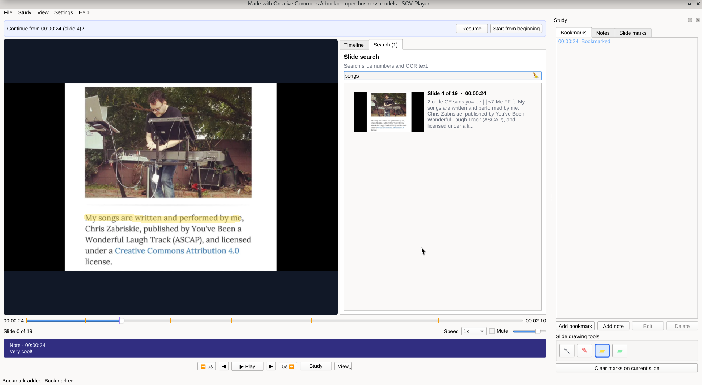
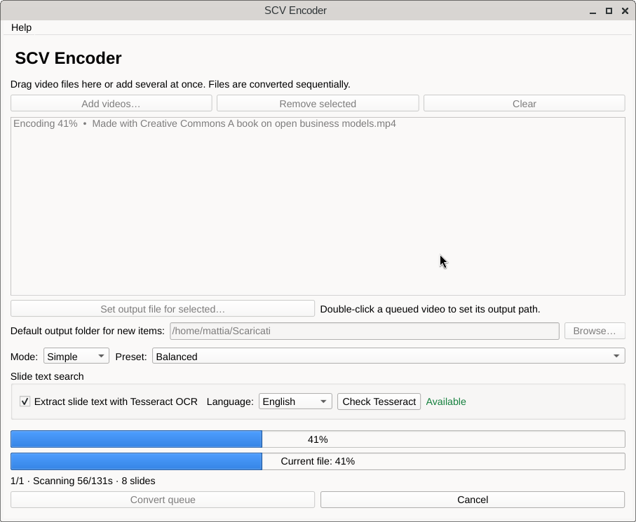

# SCV Suite

> Why _SCV_? Because it is a _Slide Change Video_ format.

SCV Suite is a desktop toolkit for recorded lectures whose visual content is
mostly static. It stores audio as Opus and represents slides as timestamped
WebP images in a `.scv` archive. It encodes only slide changes can reduce storage
while preserving readable slides and the original audio timeline.


> **Is this necessary?** After all, space is cheap today.
> Well, I guess, but saving space does not hurt.
> I got some lectures to drop from `250MB` to `8MB` while retaining good quality.

The package provides a lecture player, batch encoder, MP4 exporter, and
command-line interface. The player supports slide search, annotations,
bookmarks, notes, and optional playback resume.

 The player is written in PyQt6 and the encoder uses FFmpeg and FFprobe. The project is cross-platform and runs on Linux, Windows, and macOS.

## Screenshots




## Run

Requirements: Python 3.10+, FFmpeg and FFprobe on `PATH`, and the dependencies
in `requirements.txt`. Tesseract is required only for OCR.

```sh
python3 -m venv .venv
.venv/bin/python -m pip install -r requirements.txt
.venv/bin/python -m pip install -e .
.venv/bin/python -m scv.studio
```

Encode and play a lecture from the command line:

```sh
scv encode lecture.mp4 --output lecture.scv
scv-player lecture.scv
```

On Windows, use `.venv\Scripts\python` in place of `.venv/bin/python`.
Install Tesseract separately to enable OCR. Resume behavior can be changed in
Player Preferences.

It is possible to package SCV Suite as a portable application, though I have not done it myself, but some groundwork is laid.

See [FORMAT.md](FORMAT.md) for the archive and sidecar formats. The portable
build script is [`build/build.py`](build/build.py). SCV Suite is MIT licensed;
third-party distribution notes are in [`third_party/NOTICE.md`](third_party/NOTICE.md).
